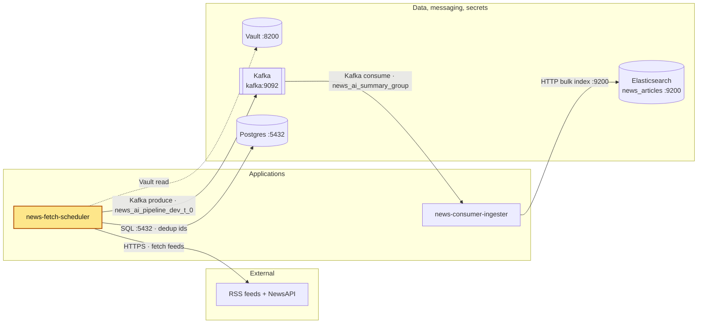

# news-fetch-scheduler

## Purpose

A long-running Python worker that, every 30 minutes, fetches news articles from RSS feeds and the
NewsAPI top-headlines endpoint, drops articles it has already published (checked against
Postgres), and publishes the new ones as JSON messages to a Kafka topic. It serves no HTTP.

Flow (`src/main.py`): `setup_logging()` → `load_secrets()` (Vault → env) → `load_setting()`
(TOML) → `schedule_fetch()`.

| Step | Code | What happens |
|---|---|---|
| Schedule | `scheduler/schedule_feed_fetch.py` | Runs the fetch job once at start (before the loop), then every `SCHEDULER_INTERVAL_MINUTES` (30), plus a daily dedup cache reload at `DEDUP_REFRESH_AT` (`00:05`, container clock = UTC). The loop sleeps `SCHEDULER_SLEEP_SECONDS` (5) between checks and touches `/tmp/heartbeat` each pass. A failing job is logged (`[Scheduler] Fetch job failed` / `[Scheduler] Dedup cache refresh failed`) and the loop continues. |
| RSS | `newsfeed/rss_feed.py` | For each feed in `RSS_FEEDS`: GET with the shared httpx client (`HTTP_TIMEOUT_SECONDS`, `follow_redirects=True`), then `feedparser.parse()`. A network or HTTP error logs one warning line for that feed and the other feeds continue. |
| NewsAPI | `newsfeed/api_feed.py` | GET `NEWS_API_URL` with `NEWS_API_PARAMS`, sending the API key in the `X-Api-Key` header (`NEWS_API_KEY` from Vault). |
| Dedup + publish | `publisher/publisher.py`, `article_dedup/article_deduplicator.py` | See below. |

Sources (from `src/resources/app-config-settings.toml`):

| Source | Type | URL |
|---|---|---|
| BBC | RSS | `https://feeds.bbci.co.uk/news/rss.xml` |
| Reuters | RSS (via Google News search) | `https://news.google.com/rss/search?q=when:24h+site:reuters.com...` |
| TechCrunch | RSS | `https://techcrunch.com/feed/` |
| Wired | RSS | `https://www.wired.com/feed/rss` |
| Hacker News | RSS (official feed, 30 front-page items) | `https://news.ycombinator.com/rss` |
| NewsAPI | REST | `https://newsapi.org/v2/top-headlines` (`language=en`, `country=us`) |

**Deduplication.** Each article's key is `link + published_at + source`, hashed with MD5. The
deduplicator keeps an in-memory `set` for lookups, backed by the Postgres table `news_article_ids`
(columns `article_id_hash`, `created_at`) so it survives restarts. On first use it warms the set
with the hashes from today and the previous `DEDUP_WINDOW_DAYS` (2) full days. `created_at` is a
`DATE`, so the window is compared in whole days (`created_at >= CURRENT_DATE - 2`). Once a day at
`DEDUP_REFRESH_AT` (`00:05`, container clock = UTC) `ArticleDeduplicator.refresh()` reloads the set
from that DB window: it loads first and then swaps, and on an error it logs and keeps the old set.
Between reloads the set therefore holds the window as of the last reload plus every article marked
seen since. An article is marked seen (row inserted with `ON CONFLICT DO NOTHING`, then added to the
set) only after Kafka confirms delivery in the `on_delivery` callback; a failed delivery is not
marked, so it is produced again next run. Duplicates within the same run are skipped.

If the DB connection drops while marking (`psycopg.OperationalError`), `_mark_seen` closes the dead
connection, builds one new deduplicator (new connection, set re-warmed) and retries once. Later calls
always use the current cached deduplicator, so a run reconnects once per connection drop, not once
per article. If the retry also fails, it is logged (`[Dedup] Could not mark article as seen; it will
be re-sent next run`, with traceback) and never aborts `flush()`; that article is produced again next
run, which is harmless because the ingester uses the key as the Elasticsearch `_id`.

**Lazy initialisation.** The Postgres connection and Kafka producer are created on the first call
to `publish_to_kafka` (`@lru_cache` factories), not at import time.

**Kafka message.**

| Part | Value |
|---|---|
| Topic | `TOPIC_NAME` = `news_ai_pipeline_dev_t_0` (3 partitions on the local broker, per the TOML comment) |
| Key | `generate_id(key)` = MD5 hex of `link + published_at + source` (the ingester uses it as the Elasticsearch `_id`) |
| Value | `Article` JSON (`common/article.py`): `source`, `title`, `summary`, `link`, `published_at`, `fetched_at` (all optional strings; dates ISO-8601) |

After producing, the producer is flushed with `KAFKA_FLUSH_TIMEOUT_SECONDS` (30); if messages
remain it logs `[Kafka] N messages not delivered before flush timeout`. Those messages are still in
the producer's queue: one may be delivered later (its callback then marks it seen), while the next
run may already produce it again because it was not yet marked. That can send a duplicate, which is
harmless (the ingester's `_id` is idempotent).

## Where it fits



The scheduler is the producer at the head of the news pipeline: it feeds the Kafka topic that
news-consumer-ingester indexes into Elasticsearch. Full system diagram:
[docker_services architecture](../docker_services/README.md#architecture).

## Depends on / Depended on by

| Direction | Component | How |
|---|---|---|
| Depends on | Vault (`vault-server:8200`) | Reads `secret/CREDENTIALS` at start-up; start fails without it. |
| Depends on | Postgres (`postgres:5432`) | Dedup table `news_article_ids`. |
| Depends on | Kafka (`kafka:9092`) | Produces to `news_ai_pipeline_dev_t_0`. |
| Depends on | RSS feeds, NewsAPI (internet, HTTPS) | Article sources. One failing source does not stop the others. |
| Depended on by | news-consumer-ingester | Consumes the topic (group `news_ai_summary_group`). |

The `news_article_ids` table is created by [`db/news_article_ids.sql`](db/news_article_ids.sql)
(idempotent; the file has the command to run it). The Kafka topic is created by
`~/github/kafka_topic_creation.sh` (3 partitions; broker auto-create is disabled).

## Config & secrets

**Environment variables** (set in `docker-compose.yml`):

| Variable | Value in compose | Purpose |
|---|---|---|
| `VAULT_ADDR` | `http://vault-server:8200` | Vault URL. Required. |
| `VAULT_TOKEN` | `${VAULT_TOKEN}` from your shell | Vault token. Required. |
| `VAULT_SECRET_PATH` | `secret/CREDENTIALS` | KV v2 path(s) under mount `secret`; comma-separated list allowed. Required. |
| `PYTHONPATH` | `src` | Import root. |

**Vault** (`config/vault_secrets.py`): reads every path in `VAULT_SECRET_PATH` and copies **all**
keys found there into the process environment. Keys this service uses:

| Key | Used by |
|---|---|
| `NEWS_API_KEY` | `newsfeed/api_feed.py` (`X-Api-Key` header) |
| `POSTGRES_DB`, `POSTGRES_USER`, `POSTGRES_PASSWORD` | `config/postgres_setup.py` |

**Config files** (`src/resources/`):

| File | Keys | Purpose |
|---|---|---|
| `app-config-settings.toml` | `RSS_FEEDS` | List of `{name, url}` feeds. |
| | `NEWS_API_URL`, `NEWS_API_PARAMS` | NewsAPI endpoint and query params. |
| | `TOPIC_NAME` | Kafka topic. |
| | `TOPIC_FLUSH_BATCH_SIZE` (100) | Not read by any code in `src/`. |
| | `KAFKA_FLUSH_TIMEOUT_SECONDS` (30) | Producer flush timeout. |
| | `SCHEDULER_INTERVAL_MINUTES` (30) | Fetch interval. |
| | `SCHEDULER_SLEEP_SECONDS` (5) | Loop sleep between schedule checks. |
| | `DEDUP_WINDOW_DAYS` (2) | Previous full days (plus today) of hashes loaded into the cache. |
| | `DEDUP_REFRESH_AT` (`"00:05"`) | Daily time (HH:MM, container clock = UTC) of the dedup cache reload. |
| | `HTTP_TIMEOUT_SECONDS` (10) | httpx timeout for feeds and NewsAPI. |
| | `DB_CONNECT_TIMEOUT_SECONDS` (10) | psycopg `connect_timeout`. |
| `kafka-client.properties` | `bootstrap.servers=kafka:9092`, `security.protocol=PLAINTEXT`, `socket.keepalive.enable`, `socket.timeout.ms`, `message.timeout.ms` (30000), `reconnect.backoff.ms`, `reconnect.backoff.max.ms` | librdkafka producer config, passed as-is to `Producer`. |
| `postgers.properties` (the typo is the real file name) | `host=postgres`, `port=5432` | Postgres host and port; DB name, user and password come from Vault. |
| `logging_config.json` | console + file handlers | Console and `/app/logs/news_fetch_scheduler.log` (`TimedRotatingFileHandler`: rotated daily at midnight UTC, 14 days kept) at INFO; root DEBUG; `httpx`/`httpcore` at WARNING. |

There are no `.env` files; `.env` is in `.dockerignore`.

**Logs:** two copies. (1) The log file `~/github/logs/news_fetch_scheduler.log` — the container's `/app/logs`, bind-mounted from `../logs` — rotated daily at midnight UTC with 14 days kept (`<name>.log.YYYY-MM-DD`). (2) The console output, which Docker keeps for `news_fetch_scheduler` (`docker logs <container>`), rotated at 3 × 10 MB per container with the oldest file deleted automatically (`logging:` in `docker-compose.yml`). The docker_services log-collector deliberately skips this container, because the log file already exists; see `docker_services/README.md` (Logs).

## Run locally

Prerequisites: the docker_services stack is up in its start order (Vault unsealed, Postgres,
Kafka), and the external networks `vault-network` and `services_network` exist.

**Docker (normal way):**

```bash
export VAULT_TOKEN=...            # your Vault token
docker compose up -d --build      # container: news_fetch_scheduler
docker logs -f news_fetch_scheduler
```

The image is a two-stage build (`uv sync --frozen --no-dev` in the builder, runtime as non-root
`appuser`). `CMD ["python", "src/main.py"]`. Logs are also written to `../logs` on the host
(bind mount to `/app/logs`).

Health check: every 60s (start period 120s, 3 retries) the container is healthy while
`/tmp/heartbeat` is less than 300s old. On first start the file only appears after the first fetch
job finishes, because that job runs before the loop; the 120s start period covers it.

**On the host (without Docker):**

```bash
uv sync
export VAULT_ADDR=http://vault-server:8200   # host name mapped to 127.0.0.1 in /etc/hosts
export VAULT_TOKEN=...
export VAULT_SECRET_PATH=secret/CREDENTIALS
uv run python src/main.py
```

Caveats from the config: the host names `vault-server` and `postgres` (`postgers.properties`
has `host=postgres`) must resolve on the host, e.g. mapped to 127.0.0.1 in `/etc/hosts`.
`kafka:9092` is the in-network listener; the Kafka container publishes only `localhost:29092` to
the host, so a host run needs a local, uncommitted edit of `bootstrap.servers` in
`kafka-client.properties`. If `/app/logs` does not exist, logging falls back
to console-only and logs `Failed to load application logging`.

## Test

```bash
uv sync                      # includes the dev group (pytest, pytest-mock, pytest-cov, mypy)
uv run pytest                # 129 tests
uv run pytest --cov          # with coverage: 100%, fails below 90% ([tool.coverage] in pyproject.toml)
uv run mypy --strict src
```

No real Postgres, Kafka or HTTP is used: `tests/conftest.py` patches `psycopg.connect` and
`confluent_kafka.Producer` before collection (a guard against any real connection or producer, since
`publisher.py` creates them lazily) and loads the real TOML settings for the session.
Tests mirror `src/` with a `_test.py` suffix.

## Ports

None published, and it serves no HTTP (no listener, no `ports:` in compose). Outbound only:

| Target | Address | Purpose |
|---|---|---|
| Kafka | `kafka:9092` (PLAINTEXT) | Produce articles |
| Postgres | `postgres:5432` | Dedup table |
| Vault | `vault-server:8200` | Secrets at start-up |
| Feeds, NewsAPI | HTTPS 443 | Article sources |

## Troubleshooting

| Symptom (log line) | Cause | Fix |
|---|---|---|
| `ValueError: VAULT_ADDR and VAULT_TOKEN must be set` / `VAULT_SECRET_PATH must be set` | Env var missing. | `export VAULT_TOKEN` before `docker compose up`; set the others for host runs. |
| `Vault authentication failed - check token information...` | Token invalid or expired. | Use a valid token. |
| Traceback at start-up from `client.is_authenticated()` (e.g. `hvac.exceptions.VaultDown`, `requests.exceptions.ConnectionError`); container restart loop | Vault sealed or unreachable. The check runs outside the `try`, so the error is not wrapped. | Start and unseal Vault; check `vault-server` is on `vault-network`. |
| `Exception while reading secrets from vault :- <Type>` | The secret path is missing or unreadable (e.g. `InvalidPath`, `Forbidden`). | Check `VAULT_SECRET_PATH=secret/CREDENTIALS` and the token's policy. |
| `[RSS] Failed to fetch <feed>: ConnectError: ...` | DNS or network failure for that feed. Example: the router DNS sinkholed `hnrss.org`, so Hacker News now uses `news.ycombinator.com/rss` (see the comment in `app-config-settings.toml`). | Check DNS from the container; change the feed URL in the TOML. |
| `[RSS] Failed to fetch <feed>: HTTP <code>` | Feed down or blocking the client. | Check the URL in a browser; replace or remove the feed. |
| `[API] Failed to fetch articles: HTTP 401` | `NEWS_API_KEY` missing or invalid (empty header is sent if missing). | Set `NEWS_API_KEY` in `secret/CREDENTIALS`. |
| `[Scheduler] Fetch job failed` with `psycopg.OperationalError` | Postgres down or wrong credentials at first connect. The job retries next interval. | Start Postgres; check the `POSTGRES_*` keys and `postgers.properties`. |
| `[Scheduler] Fetch job failed` with `UndefinedTable` | `news_article_ids` does not exist. | Run `db/news_article_ids.sql` (see the command in the file). |
| `[Dedup] Database connection lost, reconnecting once` | Postgres connection dropped. One reconnect per drop. | Nothing, if no error follows; otherwise check Postgres. |
| `[Dedup] Could not mark article as seen; it will be re-sent next run` | Reconnect or retried insert failed. Publishing continues. | Check Postgres; the article is produced again next run (harmless). |
| `[Kafka] N messages not delivered before flush timeout` / `[Kafka] Delivery failed for key = ...` | Broker unreachable or topic problem. Those articles are not marked seen (a message still in flight may be delivered and marked later). | Check `kafka` is up on `services_network`; unmarked articles are produced again next run (a possible duplicate is harmless). |
| `Published 0 articles after dedup` every run | Everything fetched is already in the dedup cache: seen today or in the previous `DEDUP_WINDOW_DAYS` (2) full days (as of the last daily reload at `DEDUP_REFRESH_AT`), or marked seen since that reload. | Normal between news cycles. |
| Container `unhealthy` | `/tmp/heartbeat` older than 300s: the process hung, or one fetch job ran longer than 5 minutes (the job blocks the loop). | `docker logs news_fetch_scheduler`; restart the container. |
| `Failed to load application logging` | `/app/logs` missing or not writable (host run). | Create the directory, or ignore: console logging still works. |
